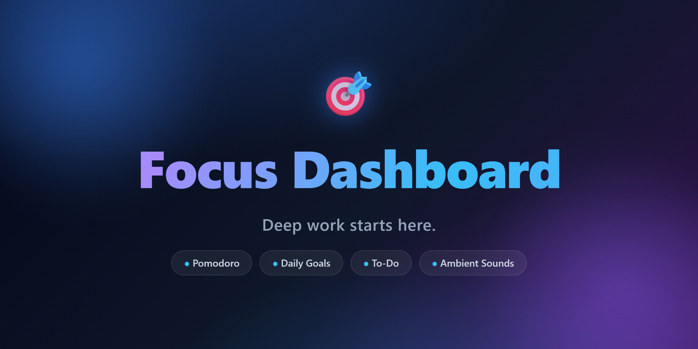

<p align="center">
  
</p>

<h1 align="center">🎯 Focus Dashboard</h1>

<p align="center">
  <strong>Deep work starts here.</strong><br/>
  A beautiful, modern, minimal, distraction-free single-page workspace for studying and working.
</p>

<p align="center">
  
  
  
  
  
  
</p>

---

## 🚀 Live Demo

<a href="https://haseeb35.github.io/Focus-Dashboard/">
  
</a>

**→ https://haseeb35.github.io/Focus-Dashboard/**

Everything runs entirely in your browser — no backend, no login, no external API. All data is stored locally with **Local Storage**.

---

## ✨ Features

### ⏱️ Pomodoro Timer
- Large circular timer with an animated **gradient progress ring** and glowing halo while running
- Focus / Short Break / Long Break with **auto-cycling** (4 focus sessions → long break)
- Configurable durations (15/25/30/45/60 min focus, 5/10/15 short, 15/20/30 long)
- Session counter, **falling confetti** + bell + completion sound, floating motivational message

### 🎯 Daily Goals
- Add, complete and delete daily goals with an animated **progress bar**
- Counter `3 / 5 complete` and a celebration when all goals are done

### ✅ To-Do List
- Priorities (High / Medium / Low), **drag & drop** reordering, inline editing, delete
- **Search** and filters (All / Active / Completed), live task counter

### 🌧️ Ambient Sound Mixer
- 8 **real, studio-quality seamless-looping** ambient tracks: Rain, Ocean, Forest, Fireplace, Coffee Shop, Wind, Birds, Piano
- Each sound plays its own **animated visual effect** in the widget background (falling rain, waves, embers, steam, floating notes…)
- Play multiple sounds simultaneously, per-sound volume, master volume + mute
- White / Pink / Brown noise generator
- Selected sounds are remembered between sessions

### 📊 Focus Statistics
- Today's focus time, sessions, tasks & goals completed
- Animated **streak flame** and a GitHub-style **weekly heatmap** of focus sessions

### 💬 Inspirational Quotes
- Random quote with smooth animated transitions, refresh with one click

### 📝 Notes
- Auto-saving scratchpad — just write, it remembers

### 🧘 Fullscreen Focus Mode
- One click (`F`) enters a distraction-free overlay — giant timer, current task, quote
- `Esc` exits. Live clock + greeting in the header

### 🎨 Polish
- **Glassmorphism** cards with sheen, glow and hover lift
- Animated gradient background with drifting blobs, aurora glow and floating particles
- **Dark / Light mode** with smooth transitions
- **4 accent colors** (Blue, Green, Purple, Orange) and **5 background themes** (Minimal, Mountains, Forest, Space, Ocean)
- Custom cursor, loading skeletons, toast notifications, live clock with time-based greeting
- **Export / Import** all data as JSON backup
- Fully responsive — mobile, tablet and desktop

---

## ⌨️ Keyboard Shortcuts

| Key | Action |
|-----|--------|
| `Space` | Start / Pause timer |
| `F` | Enter focus mode |
| `N` | Focus new task input |
| `M` | Mute ambient sounds |
| `Esc` | Exit focus mode |

> Shortcuts are disabled while you're typing in a field.

---

## 🛠️ Tech Stack

| | |
|---|---|
| **Framework** | React 18 + Vite 5 |
| **Styling** | Tailwind CSS 3 |
| **Animation** | Framer Motion 11 |
| **Icons** | React Icons (Bootstrap Icons) |
| **Audio** | HTML5 Web Audio API + bundled WAV assets |
| **Persistence** | Local Storage |

---

## 🚀 Getting Started

```bash
# 1. Install dependencies
npm install

# 2. Start the dev server
npm run dev

# 3. Build for production
npm run build

# 4. Preview the production build
npm run preview
```

---

## 📁 Project Structure

```
Focus-Dashboard/
├── scripts/
│   └── generate-audio.mjs        # DSP synth → seamless WAV loops
├── src/
│   ├── assets/
│   │   └── audio/                # 8 bundled ambient loops
│   ├── audio/
│   │   ├── ambient.js            # Web Audio engine (noise generator)
│   │   └── sfx.js                # UI sound effects
│   ├── components/
│   │   ├── Header.jsx            # logo, clock, theme/fullscreen/settings
│   │   ├── Sidebar.jsx           # quick section navigation
│   │   ├── Timer.jsx             # pomodoro with gradient ring + confetti
│   │   ├── DailyGoals.jsx
│   │   ├── TodoList.jsx          # priorities, search, drag & drop
│   │   ├── AmbientSounds.jsx     # mixer + animated visuals
│   │   ├── SoundVisual.jsx       # per-sound background animations
│   │   ├── QuoteCard.jsx
│   │   ├── Stats.jsx             # streak + heatmap
│   │   ├── Notes.jsx
│   │   ├── FullscreenMode.jsx    # distraction-free overlay
│   │   ├── Settings.jsx          # themes, accents, backup
│   │   ├── Background.jsx        # animated gradient + particles
│   │   └── Footer.jsx
│   ├── hooks/
│   │   ├── useLocalStorage.js
│   │   ├── usePomodoro.js
│   │   └── useDarkMode.js
│   ├── data/
│   │   ├── quotes.js
│   │   └── sounds.js
│   ├── App.jsx
│   ├── main.jsx
│   └── index.css
├── index.html
├── banner.png                    # repo banner
└── package.json
```

---

## 🔊 Regenerating the Ambient Sounds

The 8 ambient loops are high-quality, seamless-looping WAV files generated with a custom DSP script. To tweak or regenerate them:

```bash
node scripts/generate-audio.mjs
```

The script synthesizes each sound (filtered noise, envelopes, chirps, crackles, chords) and crossfades the loop edges so there are **zero clicks or pops**.

---

## 🌐 Deploying

This repo includes a **GitHub Actions workflow** (`.github/workflows/deploy.yml`) that builds the site and publishes it to **GitHub Pages** automatically on every push to `main`.

**One-time setup** (if Pages isn't already active):
1. Go to repo **Settings → Pages**
2. Under **Build and deployment → Source**, select **GitHub Actions**

The site deploys to:
```
https://<your-username>.github.io/Focus-Dashboard/
```

To deploy anywhere else (Netlify, Vercel):
```bash
npm run build   # outputs to dist/
```
Then upload the `dist/` folder.

---

## 🔒 Privacy

All data lives in your browser's Local Storage on your own device. Nothing is uploaded anywhere — 100% private and offline-friendly.

---

## 📄 License

MIT — made with ❤️ for productive minds.
